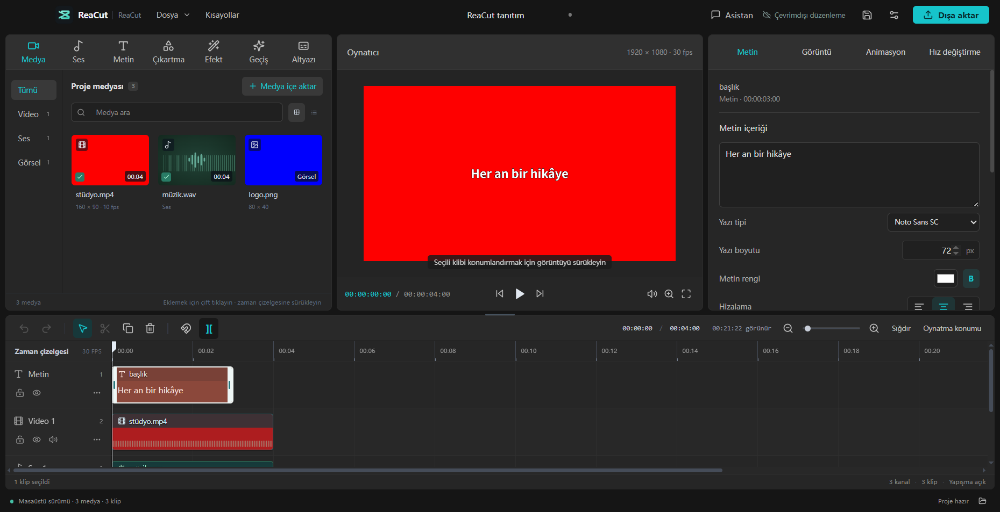

<p align="center">
  
</p>
<h1 align="center">CevikEdit</h1>
<p align="center"><strong>An independent, open-source video editor rebuilt from <a href="https://github.com/morluto/rea">REA</a>-assisted research into Jianying / CapCut.</strong><br />macOS first. Research is limited to authorized scope, without copying proprietary Jianying / CapCut code or assets.</p>
<p align="center">Building a complete video editor is a substantial undertaking, and this project is still in its early stages.<br /><strong>Contributors are welcome to help with features, usability, cross-platform support, tests and documentation.</strong> <a href="#contributing">Get involved →</a></p>
<p align="center">
  <a href="LICENSE"></a>
  
  
</p>
<p align="center">
  <a href="README.md">Türkçe</a> · English<br />
  <a href="https://sonosmanli55.github.io/CevikEdit/">Website</a> · <a href="#getting-started">Getting started</a> · <a href="docs/USER_GUIDE.md">User guide</a> · <a href="docs/WEEKLY_TODO.md">Weekly feature plan</a> · <a href="CHANGELOG.md">Changelog</a> · <a href="#contributing">Contributing</a>
</p>



CevikEdit brings media management, multitrack editing, subtitles and video export into a familiar desktop workspace. Core editing runs locally, without an account or cloud service.

The project uses [REA](https://github.com/morluto/rea) to study Jianying's interface behavior and local project formats, then independently implements an editor with Electron, React, TypeScript and FFmpeg. REA supports development research; REA, Ghidra and Jianying are not runtime dependencies.

> **Current release: v0.12.0 — free multi-select in the media library.** The installer ships FFmpeg 8.0 and FFprobe; discovery checks bundled folders, your saved override, `PATH`, then WinGet / Chocolatey / Scoop / Homebrew locations. Drag & drop now works for files that carry no OS path. The interface is Turkish only. Windows x64 NSIS was built and launched on this machine; macOS was not rebuilt this cycle and Linux is unverified. See the [website](https://sonosmanli55.github.io/CevikEdit/) and the [latest release](https://github.com/sonosmanli55/CevikEdit/releases). A 30-second showcase is in [docs/media/hafta-demosu.mp4](docs/media/hafta-demosu.mp4); per-feature evidence is in [docs/VALIDATION.md](docs/VALIDATION.md).

## Features

| Area | What you can do |
| --- | --- |
| **Media and source preview** | Import video, audio and images with thumbnails and waveforms; mark source in/out points with I/O and insert the selected range. |
| **Multitrack editing** | Drag, trim, split, duplicate, select multiple clips, snap, lock tracks, mute, undo and redo. |
| **Picture and sound** | Transform, crop, apply basic color adjustments, chroma key, rectangle / ellipse masks, keyframes, volume, fades and constant speed changes. |
| **Text and subtitles** | Import SRT / basic WebVTT, edit individual cues, batch-replace text, shift timing, copy styles and export SRT. |
| **Local projects** | Save `.cevikedit` projects, recover edits, relink media and collect project media into a portable folder. |
| **Video export** | Render the full timeline, a selection or a custom range to MP4 / MOV with H.264 and AAC. |
| **Text & effect libraries** | 16 editable text templates, 16 color / motion presets, and 8 transitions with animated previews and one-step undo. |
| **Offline assets** | Use 64 original stickers, backgrounds, title plates and synthesized sounds, plus the bundled Noto Sans SC font. |
| **Optional editing assistant** | Connect an installed, authenticated Codex CLI / Claude Code; review edit proposals before applying them and undo in one step. |

See the [feature matrix](docs/FEATURE_MATRIX.md) for detailed support and limitations.

## Getting started

### Option 1: Windows installer or one-click launcher

Download the [CevikEdit 0.12.0 installer](https://github.com/sonosmanli55/CevikEdit/releases/latest) (`CevikEdit-Kurulum.exe`) and run it. If you prefer a ~200 KB download that fetches and installs the app in the background, use `CevikEdit-Kurucu.exe` from the same release; it asks before downloading and installing anything.

The [macOS 0.5.0 DMG](https://github.com/sonosmanli55/CevikEdit/releases/tag/v0.5.0) remains available for Apple Silicon; it is ad-hoc signed, not Apple-notarized, and has not been rebuilt since this week's work.

### Option 2: inside the Codex side panel

Install **CevikEdit 0.12.0+**, Codex desktop, its `codex` CLI, and Python 3. Download the [Codex plugin ZIP](https://github.com/sonosmanli55/CevikEdit/releases/latest), then run from its extracted directory or this repository:

```sh
sh scripts/install-plugin.sh
```

Reconnect or open a new Codex chat and ask: **“Open CevikEdit in the side panel.”** Use the full editor directly with the mouse and keyboard, or ask Codex to make reversible timeline edits. If the app is elsewhere, pass `--app /absolute/path/CevikEdit.app`.

The plugin runs the local editor in a separate session. Its interactive stream is about 6 fps; file selection uses native dialogs, and audio plays locally. Codex receives requested project summaries, text, and explicit screenshots. See the [plugin guide](docs/CODEX_PLUGIN.md) for setup, data boundaries, and limitations.

### Run from source

Clone or download this repository, then run the following commands in its directory. Requirements:

- **Node.js 26**, or **Node.js 24.x starting at 24.11**, and npm.
- **FFmpeg and FFprobe**, with `libx264` and AAC encoding enabled in FFmpeg.

```sh
npm ci
npm run dev
```

This launches the Electron editor and the local Vite development server. Put the media tools on `PATH` or select their paths in application settings; see [media tools](docs/MEDIA_TOOLS.md).

To try a complete example project:

```sh
npm run demo
```

Open `.demo/demo.cevikedit` in CevikEdit. It includes programmatically generated original footage, music, subtitles and keyframes. See the [demo guide](docs/DEMO.md).

### Build a macOS installer

Install Xcode command line tools on a native macOS host, then run:

```sh
npm run dist:mac:installer
```

DMG and ZIP files are written to `release/`. The first build downloads and compiles bundled FFmpeg / FFprobe; installer users do not need to install media tools separately. Open the DMG and drag CevikEdit into Applications.

Current builds use local ad-hoc signing and are not Apple-notarized. See [validation](docs/VALIDATION.md) and [media tools](docs/MEDIA_TOOLS.md) for platform coverage and build details.

## Projects and data

- **Local editing:** media processing, preview, project storage and export run on your machine. Ordinary projects reference local media; collect project media or relink files when moving between machines.
- **Optional assistant:** when you send a message, text and a limited timeline summary are sent to the selected CLI service. Media files are not attached. See the [assistant guide](docs/ASSISTANT.md).
- **Experimental Jianying import:** converts basic clips from verified formats. Complex text styles, effects and keyframes may be lost; writing back to Jianying format is unsupported. See [interoperability](docs/CAPCUT_INTEROP.md) for version coverage.

Cloud sync, SaaS, direct AI API integration, speech-to-subtitle transcription and AI portrait cutout are not implemented. CevikEdit is an independent project and is not affiliated with Jianying / CapCut.

## Development

```sh
npm run check          # Type checks, unit tests and production build
npm run test:desktop   # Build and test the basic desktop workflow
npm run check:desktop  # Full desktop regression suite
```

See [validation](docs/VALIDATION.md) for specialized tests, prerequisites and recorded results.

```text
src/components/   Editor interface
src/editor/       State, undo/redo and preview
src/core/         Project model, timeline, subtitles and visual processing
electron/         Local file bridge, media processing and export
scripts/          Asset, icon and package build tools
tests/            Core logic, media and desktop workflow tests
docs/             User guides, architecture and research notes
```

## Contributing

Bug reports, documentation improvements and pull requests are welcome. Useful areas include Windows / Linux testing, large-project performance, editing interactions and accessibility.

1. Include your OS, CevikEdit version, reproduction steps and expected behavior in bug reports. For media issues, use a minimal sample that can be shared publicly.
2. Discuss substantial feature changes in an issue before starting a large implementation.
3. Run `npm run check` for code changes. For desktop interactions or export changes, run the relevant workflow checks and describe the results in your PR.

Use media you own or can redistribute. Keep private projects, caches, credentials and raw `.research/` data out of contributions.

## Documentation

Most detailed guides are currently in Turkish.

| Audience | Guides |
| --- | --- |
| Users | [User guide](docs/USER_GUIDE.md) · [Demo project](docs/DEMO.md) · [Editing assistant](docs/ASSISTANT.md) |
| Capabilities and progress | [Feature matrix](docs/FEATURE_MATRIX.md) · [Changelog](CHANGELOG.md) · [Validation](docs/VALIDATION.md) |
| Developers | [Architecture](docs/ARCHITECTURE.md) · [Media tools](docs/MEDIA_TOOLS.md) · [Offline assets](docs/ORIGINAL_ASSETS.md) |
| REA research and interoperability | [REA findings](docs/research/REA_FINDINGS.md) · [Interface comparison](docs/UI_PARITY.md) · [Draft interoperability](docs/CAPCUT_INTEROP.md) |

## License and acknowledgments

CevikEdit's own source code is licensed under the [MIT License](LICENSE). Third-party components retain their respective licenses: bundled FFmpeg / x264 use GPL, and Noto Sans SC uses SIL OFL 1.1. Notices, licenses and corresponding media-tool sources accompany the package; see [third-party notices](THIRD_PARTY_NOTICES.md).

Thanks to [REA](https://github.com/morluto/rea) and the Electron, React, FFmpeg, Zustand, Lucide and Noto communities.
