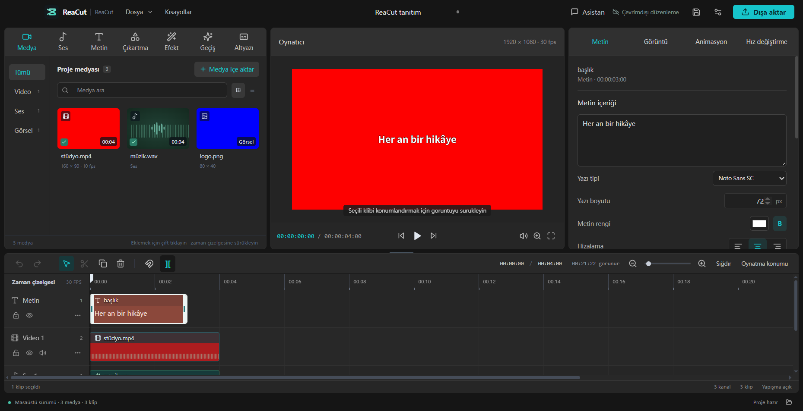

<p align="center">
  
</p>
<h1 align="center">CevikEdit</h1>
<p align="center"><strong><a href="https://github.com/morluto/rea">REA</a> ile CapCut'ı inceleyerek bağımsız olarak yeniden yazılmış açık kaynak video düzenleyici.</strong><br />Masaüstü öncelikli; yalnızca yetkili kapsamda araştırma yapılır, CapCut'un tescilli kodu veya medyası kopyalanmaz.</p>
<p align="center">Tam bir video düzenleyicisi büyük bir iştir ve proje hâlâ erken aşamadadır.<br /><strong>Katkıda bulunanları özellikler, etkileşim, platform desteği, testler ve belgeler için bekliyoruz.</strong> <a href="#katkıda-bulunma">Katkıda bulunma →</a></p>
<p align="center">
  <a href="LICENSE"></a>
  
  
</p>
<p align="center">
  Türkçe · <a href="README.en.md">English</a><br />
  <a href="#hızlı-başlangıç">Hızlı başlangıç</a> · <a href="docs/USER_GUIDE.md">Kullanım kılavuzu</a> · <a href="docs/WEEKLY_TODO.md">Haftalık özellik planı</a> · <a href="CHANGELOG.md">Değişiklik günlüğü</a> · <a href="#katkıda-bulunma">Katkıda bulunma</a>
</p>



CevikEdit medya yönetimini, çok kanallı kurguyu, altyazıları ve video dışa aktarmayı tanıdık bir masaüstü çalışma alanında birleştirir. Temel kurgu akışı yerel olarak çalışır; hesap veya bulut hizmeti gerekmez.

Proje, CapCut'un arayüz davranışını ve yerel proje biçimini incelemek için [REA](https://github.com/morluto/rea) kullanır; düzenleyicinin kendisi Electron, React, TypeScript ve FFmpeg ile bağımsız olarak yazılmıştır. REA bir geliştirme araştırma aracıdır; CevikEdit'i çalıştırmak için REA, Ghidra veya CapCut kurmak gerekmez.

> **Geçerli sürüm: v0.12.0.** Kurulum paketi FFmpeg 8.0 ve FFprobe'u kendi içinde taşır; araç keşfi gömülü dizin, kullanıcı ayarı, `PATH` ve WinGet/Chocolatey/Scoop/Homebrew konumlarını sırayla dener. Sürükle-bırak, dosya yolu taşımayan bırakmalar için de çalışır. Arayüz yalnızca Türkçedir. Önizlemede köşe tutamaçlarıyla klip ölçeklenir; proje medyasında Ctrl/Shift ile çoklu seçim yapılıp topluca zaman çizelgesine eklenir; cetvelden sürükleyerek zaman ölçeği genişletilir; geçiş, efekt, hareket, metin ve yerleşik malzeme kütüphanelerden sürükle-bırak ile uygulanır. Medya sürüklerken kanal seçmeniz gerekmez: video video kanalına, ses ses kanalına otomatik yerleşir. Windows x64 NSIS kurulumu bu makinede derlenmiş ve başlatılmıştır; macOS paketi bu sürümde yeniden derlenmemiştir, Linux doğrulanmamıştır. Sürümler için [GitHub Releases](https://github.com/sonosmanli55/CevikEdit/releases) sayfasına bakın. 30 saniyelik demo: [docs/media/hafta-demosu.mp4](docs/media/hafta-demosu.mp4); kanıtlar: [Yerel doğrulama kaydı](docs/VALIDATION.md).

## Temel özellikler

| Yetenek | Neler yapılabilir |
| --- | --- |
| **Medya ve kaynak önizleme** | Video, ses ve görsel içe aktarın; küçük görselleri ve dalga biçimlerini görün; I/O işaretleriyle giriş/çıkış noktası belirleyip seçimi zaman çizelgesine ekleyin. |
| **Çok kanallı kurgu** | Sürükleme, kırpma, bölme, çoğaltma, çoklu seçim, yapışma, kanal kilitleme, sessize alma, geri alma ve yineleme. |
| **Görüntü ve ses** | Dönüştürme, kırpma, temel renk ayarı, kroma key, dikdörtgen / elips maske, anahtar kareler, ses düzeyi, geçişler ve normal hız değişimi. |
| **Metin ve altyazı** | SRT / temel WebVTT içe aktarma, cümle cümle düzenleme, toplu değiştirme, zaman kaydırma, tek tip stil ve SRT dışa aktarma. |
| **Yerel proje** | `.cevikedit` kaydetme, otomatik kurtarma, medyayı yeniden bağlama; proje medyasını taşınabilir bir klasörde toplama. |
| **Video dışa aktarma** | Tüm zaman çizelgesini, seçili aralığı veya özel aralığı H.264 / AAC kodlamalı MP4 ve MOV olarak dışa aktarma. |
| **Metin ve efekt kitaplığı** | 16 düzenlenebilir metin şablonu, 16 renk / hareket ön ayarı, 8 geçiş; canlı önizleme ve tek geri alma adımı. |
| **Çevrimdışı medya** | 64 özgün çıkartma, arka plan, başlık zemini ve sentezlenmiş ses efekti ile Noto Sans SC yazı tipi. |
| **Codex eklentisi** | Codex'in sağ panelinde tam düzenleyiciyi kullanma; projeyi okuma, medya içe aktarma, toplu düzenleme ve geri alma. |
| **İsteğe bağlı kurgu asistanı** | Kurulu ve oturum açılmış Codex CLI / Claude Code'a bağlanma; önerileri gözden geçirip uygulama, tek adımda geri alma. |

Tam destek kapsamı ve sınırlamalar için [özellik matrisi](docs/FEATURE_MATRIX.md).

## Hızlı başlangıç

### Yol 1: Tek tıkla Windows kurulumu

[GitHub Releases](https://github.com/sonosmanli55/CevikEdit/releases) sayfasından `CevikEdit-Kurucu.exe` dosyasını indirip çalıştırın. Yaklaşık 200 KB'lık başlatıcı, uygulamayı arka planda indirir ve kurar; kurulum yalnızca sizin tıklamanızla başlar, sessizce çalışmaz. Kurulumdan sonra güncellemeleri uygulama içindeki **Güncelleme merkezi** üzerinden denetleyebilirsiniz. Ağ trafiği yalnızca GitHub sürüm dosyaları içindir; proje, medya veya telemetri yüklenmez.

### Yol 2: Codex eklentisi olarak sağ panelde açma

Önce **CevikEdit 0.12.0+** ve Codex masaüstü uygulamasını kurun; terminalde `codex` CLI ve Python 3 bulunmalıdır. Depodaki eklenti paketini indirip (veya depoyu klonlayıp) şu komutu çalıştırın:

```sh
sh scripts/install-plugin.sh
```

Codex sohbetini yeniden bağlayın veya yeni bir sohbet açın ve **"CevikEdit ile video düzenleyiciyi sağda aç"** yazın. Kenar çubuğunda tıklayabilir, sürükleyebilir, yazabilir, kaydedebilir ve dışa aktarabilirsiniz; Codex'ten geçerli projeye göre geri alınabilir toplu kurgu da isteyebilirsiniz.

Eklenti yerel düzenleyiciyi kullanır; canlı görüntü yaklaşık 6 fps'dir ve dosya seçimi sistem iletişim kutularını açar. Uygulama "Applications" klasöründe değilse `--app /absolute/path/CevikEdit.app` kullanın. Kurulum, kullanım ve sınırlamalar için [Codex eklentisi belgesi](docs/CODEX_PLUGIN.md).

### Kaynaktan çalıştırma

Depoyu klonlayın veya indirin, ardından proje dizininde şunları çalıştırın. Gereksinimler:

- **Node.js 26** veya Node.js **24.11+ 24.x** sürümü ve npm.
- **FFmpeg ve FFprobe**; FFmpeg `libx264` ve AAC kodlama desteği içermelidir.

```sh
npm ci
npm run dev
```

Bu komut Electron masaüstü düzenleyicisini ve yerel Vite geliştirme sunucusunu başlatır. Medya araçları `PATH` içinde olabilir veya uygulama ayarlarından yol belirtilebilir; ayrıntılar [medya araçları belgesinde](docs/MEDIA_TOOLS.md).

Hazır bir projeyi denemek için:

```sh
npm run demo
```

Ardından CevikEdit içinde `.demo/demo.cevikedit` dosyasını açın. Programla üretilmiş özgün görüntüler, müzik, altyazılar ve anahtar kareler içerir; ayrıntılar [demo projesi](docs/DEMO.md).

### macOS kurulum paketi oluşturma

Yerel bir macOS makinesinde Xcode komut satırı araçlarını kurun, ardından:

```sh
npm run dist:mac:installer
```

DMG ve ZIP `release/` dizinine yazılır. İlk derleme gömülü FFmpeg / FFprobe'u indirip derler; paket kullanıcılarının medya araçlarını ayrıca kurması gerekmez. DMG'yi açtıktan sonra CevikEdit'i "Applications" klasörüne sürükleyin.

Geçerli paket yerel ad-hoc imza kullanır ve Apple noter onayından geçmemiştir. Platform doğrulaması ve derleme ayrıntıları için [doğrulama kaydı](docs/VALIDATION.md) ve [medya araçları belgesi](docs/MEDIA_TOOLS.md).

## Proje ve veriler

- **Yerel düzenleme**: Medya işleme, önizleme, proje kaydetme ve dışa aktarma tamamen bu makinede yapılır; normal projeler yerel medyaya başvurur, başka makinede kullanmak için medyayı toplayabilir veya yeniden bağlayabilirsiniz.
- **Codex eklentisi**: Medya işleme yerelde çalışır; Codex araçların döndürdüğü proje özetlerini, metinleri ve açıkça alınan ekran görüntülerini alabilir. Kenar çubuğundaki canlı kareler yalnızca arayüz içindir.
- **İsteğe bağlı asistan**: Yalnızca kullanıcı mesaj gönderdiğinde seçili CLI hizmetine metin ve sınırlı zaman çizelgesi özeti gönderilir; medya dosyaları eklenmez. Ayrıntılar [asistan belgesinde](docs/ASSISTANT.md).
- **Deneysel CapCut içe aktarma**: Doğrulanmış biçimlerde temel klip dönüşümü desteklenir; karmaşık metin stilleri, efektler ve anahtar kareler kaybolabilir, CapCut biçimine geri yazma desteklenmez. Sürüm kapsamı için [birlikte çalışabilirlik belgesi](docs/CAPCUT_INTEROP.md).

Bulut eşitleme, SaaS, doğrudan API yapay zekâsı, otomatik sesli altyazı ve yapay zekâ ile kişi maskeleme henüz uygulanmamıştır. CevikEdit bağımsız bir projedir; CapCut ile bağlantılı değildir.

## Geliştirme

```sh
npm run check          # tür denetimi, birim testleri ve üretim derlemesi
npm run test:desktop   # derleyip masaüstü temel iş akışı testlerini çalıştırır
npm run check:desktop  # tam masaüstü regresyonu
```

Diğer özel testler, çalışma koşulları ve yürütülen kabul sonuçları için [doğrulama kaydı](docs/VALIDATION.md).

```text
src/components/   düzenleyici arayüzü
src/editor/       durum yönetimi, geri alma/yineleme ve önizleme
src/core/         proje modeli, zaman çizelgesi, altyazı ve görüntü işleme
electron/         yerel dosya köprüsü, medya işleme ve dışa aktarma
scripts/          medya, simge ve kurulum paketi derleme araçları
tests/            çekirdek mantık, medya ve masaüstü iş akışı testleri
docs/             kullanıcı belgeleri, mimari ve araştırma kayıtları
```

## Katkıda bulunma

Hata bildirimleri, belge iyileştirmeleri ve Pull Request'ler memnuniyetle karşılanır. Özellikle Windows / Linux gerçek donanım doğrulaması, büyük proje performans iyileştirmeleri, kurgu etkileşimi ve erişilebilirlik katkıları beklenir.

1. Hata bildirirken sistemi, CevikEdit sürümünü, yeniden üretme adımlarını ve beklenen davranışı ekleyin; medya sorunlarında mümkünse herkese açık en küçük örneği paylaşın.
2. Büyük özellik değişikliklerinde önce bir Issue ile kapsamı tartışın, sonra odaklı bir değişiklik gönderin.
3. Kod değişikliklerinde `npm run check` çalıştırın; masaüstü etkileşimi veya dışa aktarma söz konusuysa ilgili iş akışı doğrulamasını ekleyip sonucu PR'da belirtin.

Lütfen kendinize ait veya dağıtılabilir medya kullanın; özel projeleri, önbellekleri, kimlik bilgilerini ya da `.research/` ham verilerini göndermeyin.

## Belgeler

| Hedef kitle | Belge |
| --- | --- |
| Kullanım ve deneme | [Kullanım kılavuzu](docs/USER_GUIDE.md) · [Demo projesi](docs/DEMO.md) · [Kurgu asistanı](docs/ASSISTANT.md) |
| Yetenekler ve ilerleme | [Özellik matrisi](docs/FEATURE_MATRIX.md) · [Değişiklik günlüğü](CHANGELOG.md) · [Doğrulama kaydı](docs/VALIDATION.md) |
| Geliştirme ve derleme | [Mimari](docs/ARCHITECTURE.md) · [Medya araçları](docs/MEDIA_TOOLS.md) · [Çevrimdışı medya](docs/ORIGINAL_ASSETS.md) |
| REA araştırması ve birlikte çalışabilirlik | [REA araştırma kaydı](docs/research/REA_FINDINGS.md) · [Arayüz yerleşimi karşılaştırması](docs/UI_PARITY.md) · [Taslak birlikte çalışabilirliği](docs/CAPCUT_INTEROP.md) |

## Lisans ve teşekkürler

CevikEdit'in kendi kaynak kodu [MIT License](LICENSE) altındadır. Üçüncü taraf bileşenler kendi lisanslarını korur: gömülü FFmpeg / x264 GPL, Noto Sans SC SIL OFL 1.1. İlgili bildirimler, lisanslar ve medya araçları kaynağı paketle birlikte sağlanır; bkz. [Üçüncü taraf bildirimleri](THIRD_PARTY_NOTICES.md).

[REA](https://github.com/morluto/rea) ile Electron, React, FFmpeg, Zustand, Lucide ve Noto gibi açık kaynak projelere teşekkürler.
