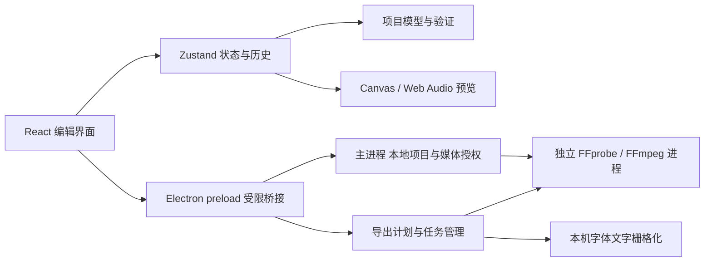

# 架构

ReaCut 的编辑模型、预览与导出由独立代码实现。REA 只用于开发阶段记录指定剪映安装包和授权测试项目的观察证据，不参与应用运行。

## 项目与编辑内核

`Project.version` 为 1。项目包含画布、帧率、背景、素材、轨道和片段；素材记录本机路径和媒体元数据，片段引用素材与轨道 ID。项目以 JSON 写入 `.reacut` 文件，不嵌入媒体。秒是统一时间单位，交互边缘通常按项目帧率取整。

`sourceIn` 是源素材入点；时间线局部时间 `t` 对应 `sourceIn + t * speed`。`duration` 是时间线时长，变速保持源范围并调整时长。视频、图片和文字按轨道次序合成；同轨重叠片段按时间次序绘制。同轨叠化通过片段重叠和后片段透明度淡入实现，暂未建立独立转场对象。

每个关键帧的 `easing` 描述结束于该帧的区间。`linear`、`easeIn`、`easeOut`、`easeInOut` 共用 `keyframeEasingWindow`、`keyframeEasingCoefficients` 与 `keyframeEasedRatio`，预览、`KeyframeEditor` 曲线采样和 FFmpeg 导出不再各自实现公式。`easingWindow` 记录曲线的截取区间；分割和裁剪加入边界锚点并重映射窗口，保持原曲线。`videoFadeWindow` 与 `audioFadeWindow` 保留原包络时长、偏移及淡入淡出范围；变速等比例缩放其秒数。手动设置淡化参数时重置对应截取窗口。

字幕样式与文字动画不新增独立求值器：样式只更新 `TextStyle` 的可编辑子集，动画由 `src/core/textAnimation.ts` 写入现有 `fadeIn`/`fadeOut` 和 x/y/缩放/透明度关键帧，入出场时长按帧吸附且不超过每条字幕一半。预览与导出因此继续共用 `evaluateFade` / `evaluateKeyframes`。字幕计划在克隆上生成并绑定 JSON 快照；拆分/合并、样式和动画各自作为一次事务提交，合并沿用最早条目的样式与局部动画。

store 使用独立快照维护撤销/重做，持续属性编辑可通过 transaction 合并为一步。轨道锁限制编辑动作；磁吸删除按同轨被删区间的并集压缩后续起点，不重复扣除重叠片段时长。锁定不影响播放或导出。轨道删除连同片段原子提交，保留媒体库并清理选择；排序不移动锁轨或交换锁定邻轨。

`validateProject(unknown)` 验证持久化输入的结构、所有必填字段、有限数值、引用、ID、类型和支持范围；返回隔离副本。外部项目不会直接以类型断言视为可信。

## 媒体与预览

macOS 安装包将独立构建的 FFmpeg/FFprobe 放在 `Contents/Resources/media-tools/`，随包保留对应源码与许可。主进程默认仅解析内置位置，缺失时明确报错；用户设置/环境变量具有优先权。源码开发及尚未内置工具的其他平台保留系统路径发现。打包前自动校验或构建当前架构工具，并核对其动态依赖仅为 macOS 系统库。

主进程使用 FFprobe 探测本地文件，通过 FFmpeg 生成缩略图、波形，以及 Chromium 无法直接解码时的本地兼容代理。素材库记录原始媒体路径；代理仅用于预览，导出仍读原文件。缓存按来源路径、文件信息与兼容参数区分，位于本地用户数据目录。倒放与定格由主进程 `clipMedia` 调用 FFmpeg：倒放把片段使用的源区间渲染为 `reverse-media` 内容寻址 MP4，画面与原有声音一起反向；定格把源帧提取为 `freeze-frames` PNG。两者只新增衍生素材，不改写源文件；项目保存绝对缓存引用，缓存不会自动清理。

播放器使用 HTML 媒体元素解码、Canvas 合成和 Web Audio gain 混音。文本默认使用随应用分发的原版 Noto Sans SC（SIL OFL 1.1）；本机字体作为可选项。基础 RGB 调整的数学操作由共享 helper 定义，导出用对应 FFmpeg 滤镜；显示缩放、视频解码、字体引擎及模糊实现仍可能造成像素差异。实时拖动先在预览状态中反馈画面与动画路径偏移，松开再提交一次编辑；项目末尾保留最终帧。预览不是颜色管理或 HDR 监看工具。

source-space 裁剪、RGB 色度抠像和矩形/椭圆蒙版采用可选项目字段与共享 source-space helper，包含整像素裁剪和 alpha 量化约定。真实桌面 UI、项目持久化及 FFmpeg 输出像素已验证，覆盖与容差见验证记录。它们不是从剪映专有算法复制的实现。

## 文件桥接与导出

renderer 没有 Node.js 权限。preload 只暴露编辑所需方法；主进程校验调用来自主窗口及主 frame。`reacut-media` scheme 提供已授权本地媒体，支持 range 请求。生产 HTML 使用 CSP；外部窗口和应用页面导航被限制。

项目和最近列表通过同目录临时文件与 rename 保存。自动保存写入串行队列。导出将源裁剪、变速、画面处理、文字图层、关键帧、淡化和混音编译为 FFmpeg filter graph，使用独立进程，不启用 shell 拼接执行。关键帧表达式使用共享缓动系数；同时启用动态缩放和透明度时，先在稳定尺寸的输入上应用 alpha，再执行逐帧缩放，避免 `alphamerge` 在帧尺寸变化时失败。

导出先写唯一临时路径，成功后替换用户选择的目标；失败或取消不把不完整视频覆盖到目标。任务报告进度，关闭应用时终止媒体和导出子进程并清理临时数据。MP4 / MOV 当前均使用 H.264 与 AAC，不是原始码流智能复制。

## 边界

云项目、登录、SaaS 与 API AI 没有服务端或隐藏实现。剪映导入由主进程负责受限目录读取、时间线选择和认证解码，平台无关转换器将已解码 JSON 转为基础时间线。当前仅验证本机受控草稿的嵌入 AES-GCM 格式，详见第二轮格式报告。Windows/Linux 的代码与构建目标需要在对应系统上独立运行验证。完整性能上限、长期大型项目编辑、HDR/专业颜色管理和所有第三方媒体编解码组合尚未验证。

## 可选 CLI 助手与内置素材

`assistantBackend.ts` 管理 CLI 发现、隔离目录、结构化输出、取消和超时；`assistantEdits.ts` 对每项操作进行白名单验证，renderer 先显示计划再一次提交。摘要明确选择可发送字段，对话按项目 ID 的 SHA-256 存储在本机。内置素材由原创 SVG/合成音频生成，安装包资源被复制到稳定的用户缓存路径再按普通媒体导入，更新应用不改变已保存工程的素材引用。详见 [助手](ASSISTANT.md) 和 [原创素材](ORIGINAL_ASSETS.md)。

## 语言与本地化

桌面版默认土耳其语：`electron/locale.ts` 的 `resolveLocale` 不再依据是否打包，统一返回 `tr`；渲染层 `activeLocale` 同样默认 `tr`。主进程菜单、原生对话框与 IPC 错误经 `tr()`/`translateText` 翻译，renderer 由 `installI18n` 在 DOM 变更时翻译中文源文案。`tr.ts` 保存精确词条，`tr-patterns.ts` 处理计数、名称与范围等运行时拼接；`scripts/i18n-audit.ts` 静态扫描所有可进入 DOM 的中文字面量与 JSX 文本。`REACUT_LOCALE=zh` 仅供既有中文断言脚本使用，不面向用户。

## v0.4 本地工作流

- SourcePreview 使用独立 HTML 媒体元素、焦点内快捷键和源入出点；卸载暂停并释放源。App 在时间线操作时返回项目播放器，store 校验选段后一次性创建片段/轨道，保留 sourceIn。
- subtitleEdits 是纯计划/应用层，字幕面板提交整项目原子修改；提案绑定创建时状态，避免覆盖随后编辑。拆分/合并、可编辑样式和统一动画都走同一计划路径：拆分复用 `splitClip` 并检查两侧至少一帧，合并只接受同轨连续且相接/重叠的条目，动画由 `textAnimation` 生成现有淡化与 x/y/缩放/透明度关键帧，预览和导出共用 `evaluateFade`/`evaluateKeyframes`。
- placement 定义源区间入轨方式：追加取轨道末尾，插入在播放头处切开跨点片段并右移后续片段，覆盖按两端切分后裁掉占用区间；结果作为整个工程一次提交。`Clip.linkId` 关联分离出的音视频，store 的移动、裁剪、分割、删除、复制/粘贴与重复按 linkId 展开，解除关联只移除该字段。
- audioMix 是纯计划层：`loudnorm` 的 stderr 汇总由主进程解析，增益与真峰值钳制、语音/音乐阈值与音量关键帧包络都在核心计算；写入沿用普通片段音量字段，因此预览与导出无需新的音频路径。
- templates 定义 `.reacut-template`：模板工程只保存 `template://media/<slot>` 占位与槽位清单，保存时丢弃未使用素材和缓存，实例化时重建全部 ID、把媒体重置到源 0 并按可用长度裁剪；`electron/templates.ts` 负责原子读写与逐文件校验，损坏文件只产生警告。
- timelineView 把时间线的比例、光标锚定缩放、可见区间、适配比例与平移边界做成纯函数；Timeline 只负责读取滚动容器并把结果同步回状态。缩放和平移属于视图状态，不进入工程或撤销栈。
- bezier 提供自由 cubic-Bézier：Newton 求根 + 二分回退，Y 允许过冲；预览用精确解，导出用 24 段折线表。keyframeRatio 统一优先使用曲线，其次具名预设。
- timelineMotion 负责惯性、指针速度与迷你地图几何；limits 负责大工程阈值、可视切片与导出内存估算；二者都是纯函数，视图状态不进入工程。
- vad 在核心层做离线语音检测（能量帧、噪声底、迟滞、合句），主进程只负责解码为 16 kHz 单声道 PCM；Ducking 接受可选检测区间。
- colorManagement 依据 FFprobe 元数据判定 PQ/HLG，导出对 HDR 图层插入 zscale + hable 链并显式输出 bt709 标记；项目本身保持 SDR。
- draftExchange 生成开放的纯文本草稿 JSON（微秒时间范围 + 完整工程侧信道），不写入第三方加密存储。
- portableProject 定义版本化 reacut-portable 封装。仅接受受限 media/UUID.ext 相对路径，解析时校验 realpath 边界；绝对媒体路径仍经现有授权协议提供给 renderer。流式复制到临时文件夹，失败/取消清理，完成后 rename；保存保留相对引用。首次 SHA-256 清单是历史记录。
- exportRange 校验时间边界和一帧下限；合成保留原时间轴，最终 trim/atrim 并重置时间戳，保持动画和淡化相位。完全在区间外的素材不进入渲染输入。

## Codex 插件

`plugin/` 包含标准与兼容 manifest、操作 skill 和 Python 启动器。0.5.1 的启动器在本地处理 MCP 初始化、工具/资源发现与固定 UI 资源读取，不启动 Electron；工具定义由 `electron/pluginProtocol.ts` 生成到 `plugin/protocol.json`，只有实际工具调用才创建一个应用子进程。子进程退出后不自动重启或重放编辑。macOS 包使用 `LSUIElement` 避免 JavaScript 执行前的 Dock 闪现，普通桌面启动显式恢复 regular 激活策略。启动已安装应用的 `--reacut-plugin` 模式后，`electron/pluginHost.ts` 提供 stdio MCP；不启动网络服务。MCP App UI 自包含在 `dist/plugin.html`，通过 SDK 的 app-only 工具拉取当前编辑器 JPEG 并发送受限输入。隐藏窗口仍保留原来的 renderer 隔离、CSP、文件授权和 FFmpeg 引擎，必要时可显示为桌面窗口。

`src/editor/pluginBridge.ts` 提供状态摘要与白名单编辑，复用 `previewAssistantEdits`，提交时校验当前 revision 和编辑事务。批量修改原子提交，支持一次撤销。每个插件连接使用独立恢复目录，防止不同聊天覆盖彼此的自动保存；正常断连先刷新自动保存再退出。模型工具不会默认返回媒体帧，显式截图与 app-only 帧分开。详情见 [插件说明](CODEX_PLUGIN.md)。
