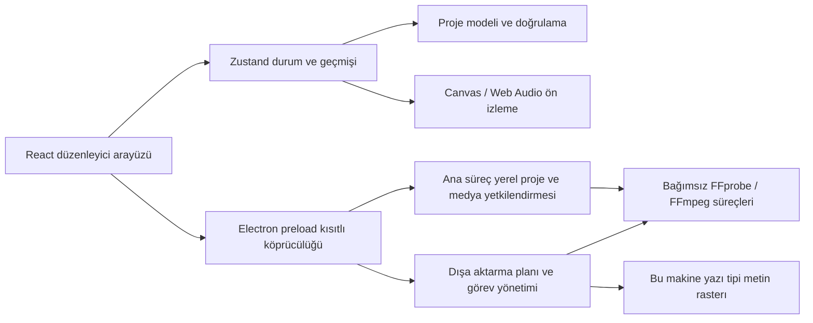

# Mimari

CevikEdit'in düzenleme modeli, önizleme ve dışa aktarma bağımsız olarak uygulanır. REA yalnızca geliştirme aşamasında belirtilen Jianying kurulum paketleri ve yetkilendirilmiş test projeleri için gözlem kanıtlarını kaydeder; uygulama çalışmasına dahil değildir.

## Proje ve düzenleme çekirdeği

`Project.version` 1'dir. Proje çerçeveyi, kare hızını, arka planı, malzemeleri, kanalları ve parçaları içerir; malzemeler yerel yolları ve medya meta verilerini kaydeder, parçalar malzemeye ve kanal kimliğine referans verir. Proje JSON olarak `.cevikedit` dosyasına yazılır, medya gömülü değildir. Saniye evrensel zaman birimidir; etkileşim kenarları genellikle proje kare hızına göre tamamlanır.

`sourceIn` kaynağın giriş noktasıdır; zaman çizelgesi yerel zamanı `sourceIn + t * speed` ile eşleşir. `duration` zaman çizelgesi süsüdür; değiştirme oranı kaynağı korur ve süreyi ayarlar. Video, resim ve metin kanal sırasıyla birleştirilir; aynı kanalda üst üste gelen parçalar zaman sırasıyla çizilir. Üst üste bindirme, parça çakışması ve sonraki parçanın şeffaf geçişiyle yapılır; şu an bağımsız geçiş nesnesi kullanılmaz.

Her kritik karenin `easing` bitiş aralığını açıklar. `linear`, `easeIn`, `easeOut`, `easeInOut` `keyframeEasingWindow`, `keyframeEasingCoefficients` ve `keyframeEasedRatio` paylaşır; önizleme, `KeyframeEditor` çizgi örnekleme ve FFmpeg dışa aktarma artık kendi formüllerini koymaz. `easingWindow` çizginin kesme aralığını tutar; bölme ve kırpma sınır noktalarını ekleyip pencereyi yeniden haritalandırır, orijinal çizgiyi korur. `videoFadeWindow` ve `audioFadeWindow` orijinal paket süresini, kayması ve fade aralığını korur; değiştirme oranı geçiş süresini orantısal olarak ölçekler. Manuel fade ayarı yapılırsa ilgili kesme penceresi sıfırlanır.

Altyazı stili ve metin animasyonu için bağımsız bir değerlendirici eklenmedi: stil yalnızca `TextStyle` içinde yer alan düzenlenebilir alt kümesini günceller; animasyon `src/core/textAnimation.ts` tarafından mevcut `fadeIn`/`fadeOut` ve x/y/ölçek/şeffaflık anahtar karelerine yazılır, giriş/çıkış süreleri kareye asitleştirilir ve her altyazı için yarısından fazla tutulmaz. Bu yüzden önizleme ve dışa aktarma aynı `evaluateFade` / `evaluateKeyframes` yolunu kullanmaya devam eder. Altyazı planı klon üzerinde oluşturulup JSON anına bağlanır; bölme / birleştirme, stil ve animasyon ayrı ayrı işlemler olarak tek bir işlem olarak commit edilir, birleştirme en eski kaydın stilini ve yerel animasyonunu alır.

Store izole anlık görüntüleriyle geri alma / yeniden kullanmayı yönetir; sürekli özellik düzenlemesi transaction olarak birleştirilerek tek adımlık işlem olabilir. Kanal kilidi düzenleme eylemlerini kısıtlar; mıknatıs silme, silinen aynı kanaldaki aralığın birleşimiyle sonraki başlangıçları sıkıştırır, tekrar eden kırpma süresi düşülmez. Kilit oynatma ya da dışa aktarmayı etkilemez. Kanal silme parçalarıyla atomik commit eder, medya kitaplığını korur ve seçimi temizler; sıralama kilitli kanalı taşımaz ya da kilitli komşu kanalı değiştirmez.

`validateProject(unknown)` yapı, zorunlu alanlar, sınırlı sayılar, referanslar, kimlikler, tipler ve desteklenen aralıkları doğrular; izole kopya döndürür. Harici proje doğrudan tip varsayımıyla güvenilir kabul edilmez.

## Medya ve önizleme

macOS paketi bağımsız derlenmiş FFmpeg/FFprobe'i `Contents/Resources/media-tools/` altına koyar, kaynak ve lisansı paketle birlikte korur. Ana süreç yalnızca yerleşik konumları varsayar, eksikse açıkça hata verir; kullanıcı ayarları / ortam değişkenleri önceliklidir. Kaynak geliştirme ve henüz yerleşik olmayan diğer platformlar için sistem yolunu kullanır. Paket öncesi mevcut mimari için araç doğrulama ya da derleme yapılır ve yalnızca macOS sistem kütüphanesi ile özel olmayan dinamik bağımlılıklar kontrol edilir.

Ana süreç yerel dosyaları FFprobe ile keşfeder, FFmpeg ile thumbnail, dalga çizgisini ve Chromium'ın doğrudan çözebilemediği yerel uyumluluk aracını üretir. Medya kitaplığı orijinal medya yollarını tutar; arac yalnızca önizleme için kullanılır, dışa aktarma orijinal dosyayı okur. Önbellek kaynak yol, dosya bilgisi ve uyumluluk parametreleriyle ayrılır, yerel kullanıcı veri dizinine konur. Geri sarma ve dondurma ana süreç `clipMedia` çağrısını FFmpeg ile yapar: geri sarma parçada kullanılan kaynak aralığını `reverse-media` içerik adresli MP4'e render eder, görüntü ve orijinal ses ters çevrilir; dondurma kaynak çerçeveyi `freeze-frames` PNG'e çıkarır. Bunlar yalnızca türetilmiş malzemeyi ekler, kaynak dosyayı değiştirmez; proje önbelleğe yönlü referansı saklar, önbellek otomatik temizlenmez.

Oyuncu HTML medya öğeleri, Canvas sentezi ve Web Audio gain karıştırıcısını kullanır. Metin varsayılan olarak uygulama ile dağıtılan orijinal Noto Sans SC'i (SIL OFL 1.1) kullanır; yerel font seçimidir. Temel RGB ayarlarının matematik işlemleri paylaşılan yardımcı ile tanımlanır, dışa aktarımda FFmpeg filtresi kullanılır; gösterim ölçeği, video decode, yazı motoru ve bulanıklık hâlâ piksel farkı yaratabilir. Gerçek zamanlı sürüklenme önce önizleme durumunda görüntü ve animasyon yolu gerilemesini bildirir, bırakma sonra tek düzenleme commit eder; proje sonuna son çerçeve korunur. Önizleme bir renk yönetimi ya da HDR izleme aracı değildir.

Kaynak uzaklığı çektirme, RGB renk kadranı kırpma ve dikdörtge / elips maskesi, opsiyonel proje alanları ve paylaşılan kaynak uzaklığı yardımcı tarafından kullanılır; piksellerde tam çektirme ve alpha nicelleştirme kuralları içerir. Gerçek masaüstü arayüzü, proje kalıcılığı ve FFmpeg çıktı pikselleri doğrulandı; kapsam ve tolerans için doğrulama kayıtlarına bakın. Bunlar Jianying özel algoritmalarından kopyalanmış uygulama değildir.

## Dosya köprücülüğü ve dışa aktarma

Renderer Node.js izniye sahip değildir. Preload yalnızca düzenlemek için gerekli yöntemleri açar; ana süreç çağrıyı ana pencere ve ana kareden gelip gelmediğini doğrular. `cevikedit-media` şeması yetkilendirilmiş yerel medyayı sağlar ve range isteklerini destekler. Üretim HTML'i CSP kullanır; dış pencereler ve uygulama sayfalarının gezinmesi kısıtlanır.

Proje ve son listeler aynı dizinde geçici dosya ile rename ile kaydedilir. Otomatik kaydetme serile kuyruğu kullanır. Dışa aktarma kaynak kırpmasını, değiştirme oranını, görüntü işlemlerini, metin katmanlarını, kritik kareleri, fades ve karıştırıcıyı FFmpeg filtre grafiğine derler, bağımsız süreç kullanır, shell ile birleştirme çalıştırılmaz. Kritik kare ifadeleri paylaşılan easing katsayılarını kullanır; dinamik ölçekleme ve şeffaflık birlikte açıkken önce sabit boyutlu girdide alpha uygular, sonra kare başına ölçekleme yapar; böylece `alphamerge` kare boyutu değişiminde başarısız olmaz.

Dışa aktarma önce benzersiz geçici yolu yazar, başarılı olduktan sonra kullanıcının seçtiği hedefi değiştirir; başarısız ya da iptalde tam video hedefe yazılmaz. Görev ilerleme raporlar, uygulama kapatıldığında medya ve dışa aktarma süreçlerini sonlandırır ve geçici verileri temizler. MP4 / MOV şu an H.264 ve AAC kullanır, orijinal akışın akıllı kopyalama yapılmaz.

## Sınırlar

Bulut projeleri, giriş, SaaS ve API AI için sunucu ya da gizli uygulama yoktur. Jianying içe aktarması ana süreç tarafından kısıtlı dizin okuması, zaman çizelgesi seçimi ve yetkilendirmeli decode ile yapılır, platform bağımsız dönüştürücü çözülen JSON'i temel zaman çizelgesine çevirir. Şu an yalnızca yerel yetkilendirmeli test taslağının gömülü AES-GCM biçimi doğrulandı; ikinci tur raporu için [DRAFT_FORMAT_ROUND2.md](research/DRAFT_FORMAT_ROUND2.md) bakın. Windows / Linux kod ve derleme hedefleri karşılığı sistemlerde ayrı ayrı doğrulanmalıdır. Tam performans sınırları, uzun süreli büyük proje düzenlemesi, HDR / profesyonel renk yönetimi ve tüm üçüncü taraf medya kod çözme kombinasyonları henüz doğrulanmadı.

## İsteğe bağlı CLI asistanı ve yerleşik malzama

`assistantBackend.ts` CLI keşfini, izole dizini, yapılandırılmış çıktıyı, iptali ve zaman aşımını yönetir; `assistantEdits.ts` her işlem için beyaz liste doğrulaması yapar, renderer önce planı gösterir sonra tek işlem olarak commit eder. Özet açıkça gönderilebilecek alanları seçer; konuşma proje kimliğinin SHA-256'si ile depoda saklanır. Yerleşik malzama orijinal SVG / sentetik sesle üretilir, paket kaynakları düzenli kullanıcı önbelleği yolına kopyalanır ve ardından normal medya gibi içe aktarılır; güncelleme mevcut projelerin malzama referansını değiştirmez. [Asistan](ASSISTANT.md) ve [Orijinal malzama](ORIGINAL_ASSETS.md) için ayrıntılar için bakın.

## Dil ve yerelleştirme

Arayüz metinleri doğrudan Türkçe yazılır; çalışma zamanı sözlük katmanı (`src/i18n/`, `electron/locale.ts`) ve `CEVIKEDIT_LOCALE` anahtarı kaldırıldı. Ana süreç menüleri, yerel diyaloglar ve IPC hataları da Türkçedir. Kullanıcı tarafından açıkça ayarlanan ya da eklenti tarafından değiştirilen metinler olduğu gibi korunur. `tests/turkish-source.test.ts`, `src` / `electron` / `plugin` / `site` altında CJK karakteri, `src/i18n` dizini ve yabancı dilli yerleşik malzeme adı bulunmadığını denetler.

## v0.4 yerel iş akışı

- SourcePreview yerel HTML medya öğesi, odak içi kısayollar ve kaynak giriş/çıkış kullanır; kaynak kullanılmadığında durur ve kaynağı serbest bırakır. App zaman çizelgesi işleminde proje oynatıcısına döner, store seçili parçayı doğruladıktan sonra tek işlemle parça / kanal oluşturur, `sourceIn`'i korur.
- subtitleEdits saf plan / uygulama katmanıdır; altyazı paneli projeyi atomik düzenler; öneriler oluşturma anındaki durumu bağlar, sonrası yapılan düzenlemeleri kapar. Bölme / birleştirme, düzenlenebilir stil ve tek tip animasyon aynı plan yolunu izler: bölme `splitClip`'u yeniden kullanır ve iki tarafın en az bir kare bırakmasını kontrol eder; birleştirme yalnızca aynı kanalda ve devam eden / örtüşen kayıtları kabul eder; animasyon `textAnimation` ile mevcut fades ve x/y/ölçek/şeffaflık anahtar karelerine üretir, önizleme ve dışa aktarma `evaluateFade`/`evaluateKeyframes` paylaşır.
- placement kaynak aralığının giriş yollarını tanımlar: ekleme kanal sonuna, ekleme ve sonları kaydırma oynatma başında kesip sonraki parçaları sağa kaydırır, üzerine yazma iki ucu kırpıp kullanılan aralığı kırpar; sonuç tüm proje olarak tek işlemle commit edilir. `Clip.linkId` ayrıştırılmış ses-video bağlar, store hareket / kırpma / bölme / silme / kopyala / yapıştırma / tekrar işlemlerini linkId üzerinden uygular, bağlantıyı kesmek yalnızca bu alanı kaldırır.
- audioMix saf plan katmanıdır: `loudnorm` stderr özetini ana süreç çözer, kazanım ve gerçek en yüksek değeri kısıtlar, ses / müzik eşiği ve ses anahtar kare paketini hesaplar; yazma normal parça ses seviyesi alanına gider, bu yüzden önizleme ve dışa aktarma yeni bir ses yolu gerekmez.
- templates `.cevikedit-template` tanımlar: şablon projesi yalnızca `template://media/<slot>` yerleştirmelerini ve slot listesini saklar, kullanılmayan malzemeyi ve önbelleği atar, örneklenirken tüm kimlikleri yeniden kurar, medyayı kaynaktan sıfıra çevirip uygulanabilir uzunluğa göre kısar; `electron/templates.ts` atomik okuma / yazmayı ve dosya başına doğrulamayı yönetir, bozuk dosya yalnızca uyarı üretir.
- timelineView zaman çizelgesinin oranını, odağı sabitleştiren ölçeğini, görünen aralığını, uyum oranını ve kaydırma sınırlarını saf fonksiyonlarla yapan; `Timeline` yalnızca kaydırma kabuğunu okur ve sonucu duruma senkronize eder. Ölçeklendirme ve kaydırma yalnızca görünüm durumudur, proje içine girmez.
- bezier özgür cubic-Bézier sağlar: Newton köklü + ikili arama geri çekme, Y aşırı geçişe izin verir; önizleme kesin çözüm, dışa aktarma 24 parçaya bölünmüş çizgi tablosu. `keyframeRatio` önce çizgi, sonra adlandırılmış ön ayarları tercih eder.
- timelineMotion gerici, dokunma yolu hızı ve mini harita geometrisini yönetir; limits büyük proje eşikleri, görünen dilimleri ve dışa aktarma bellek tahminini yönetir; ikisi de saf fonksiyon, görünüm durumu proje içine girmez.
- vad çekirdekte yerel konuşma algılama yapar (enerji çerçevesi, gürültü tabanı, gecikme, birleşme); ana süreç yalnızca 16 kHz mono PCM'e decode eder; Ducking opsiyonel algılama aralıkları kabul eder.
- colorManagement FFprobe meta verisinden PQ/HLG'i belirler, dışa aktarmada HDR katmanları için zscale + hable zincirini ve açık bt709 işaretini kullanır; proje kendisi SDR kalır.
- draftExchange açık metin taslak JSON'i (mikrosaniye zaman aralığı + tam proje) üretir, üçüncı taraf şifreli depoya yazmaz.
- portableProject sürümlenmiş `cevikedit-portable` sarmalayıcısını tanımlar. Yalnızca kısıtlı `media/UUID.ext` görecel yolları kabul eder, çözümde realpath sınırını doğrular; mutlak medya yolları mevcut yetkilendirmeli protokol üzerinden renderer'a verilir. Geçici klasöre akışlı kopyalama, başarısızlık / iptalde temizlik, sonunda rename; kaydetme göreceli referansı korur. İlk SHA-256 manifesti geçmiş kaydıdır.
- exportRange zaman sınır ve bir kare alt sınırını doğrular; sentez orijinal zaman çizelgesini korur, son trim/atrim ile zaman damgasını sıfırlar, animasyon ve fade fazını korur. Tamamen aralık dışında kalan malzama render girdisine girmez.

## Codex eklentisi

`plugin/` standart ve uyumluluk manifestları, işlem skill'i ve Python başlatıcısını içerir. 0.5.1 başlatıcısı yerel olarak MCP başlatma, araç / kaynak keşfi ve sabit UI kaynak okumalarını işler, Electron başlatmaz; araç tanımları `electron/pluginProtocol.ts` tarafından `plugin/protocol.json` üretilir, yalnızca gerçek araç çağrısında bir uygulama alt süreci başlatılır. Alt süreç çıkınca otomatik yeniden başlatma ya da yeniden oynatma yapılmaz. macOS paketi `LSUIElement` kullanır; masaüstü başlangıcı normal politiyi açıkça geri getirir, eklenti accessory kalır. `--cevikedit-plugin` modunda kurulu uygulamayı başlatılırsa `electron/pluginHost.ts` stdio MCP sağlar; ağ hizmeti başlatmaz. MCP App UI `dist/plugin.html` içinde kendi kendine tutarlı, SDK app-only aracından güncel düzenleyici JPEG'i çeker ve sınırlı girdiyi gönderir. Gizli pencere hâlâ orijinal renderer izolasyonunu, CSP'yi, dosya yetkilendirmesini ve FFmpeg motorunu korur; gerekirse masaüstü pencereği olarak gösterilebilir.

`src/editor/pluginBridge.ts` durum özetleri ve beyaz liste düzenlemeleri sunar, `previewAssistantEdits`'i yeniden kullanır ve commit öncesi güncel revizyon ve işlem bağlamını doğrular. Toplu düzenlemeler atomik commit, tek geri alma destekler. Her plugin bağlantısı ayrı kurtarma dizininde, farklı sohbetlerin otomatik kaydetmelerinin birbirini bozmasını önler; normal kopmalarda önce otomatik kaydetmeyi tazelemek sonra çıkılır. Model araçları medya çerçevesini varsayılan döndürmez, açık tarama ve app-only çerçeve ayrılır. Ayrıntılar [Eklenti açıklaması](CODEX_PLUGIN.md) içinde.
