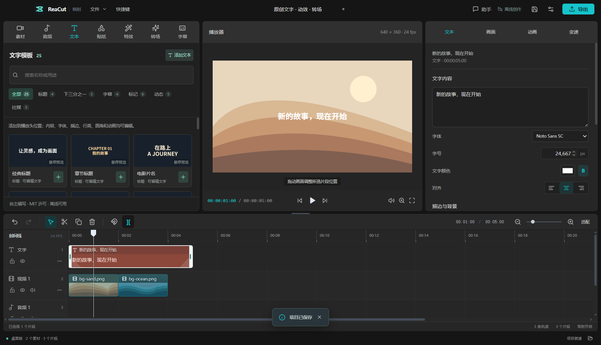

# Metin, etki ve geçiş kütüphanesi

Bu üç malzeme türü bağımsız olarak yazılmış parametrik formüllerdir, kaynakla birlikte MIT lisansıyla sunulur; indirme, giriş ya da AI API çağrısı gerektirmez. Kısayollar, proje tarafından üretilen sığın / dalga arka planları ve Noto Sans SC yazı tipiyle yapılır; arka planlar orijinal malzama paketinde, yazı tipi ayrı olarak SIL OFL 1.1'i takip eder. Jianying şablonları, üçüncü parti animasyonlar, ses kayıtları ya da marka malzemeleri kopyalanmadı.

## Metin şablonları: 25 adet

| Kategori | Şablon |
| --- | --- |
| Başlık | Klasik başlık, bölüm başlığı, film adı, minimal dergi kapağı |
| Alttan üçte | İsim alttan üçte, haber hattı, giriş hattı |
| Altyazı | Altyazı alt çubuğu, net çizgi, sıcak beyaz anlatım, röportaj alıntısı |
| İşaret | İnce mint işaret, manga vurgulama, haber hızlı, karakter adı plaketi, neon etiket, altın madalya |
| Animasyon | Hafif yükseliş, zıplama ile gelme, yumuşak açılış, nazik vedalaşma, geri sayım rakamları |
| Sosyal medya | Veri kartı, kısa video açılışı, takip isteği |

“Metin” alanında ad, örnek metin ya da amaç anahtar kelimeleriyle arama yapabilir, kategori seçebilir; kartın artı düğmesine basın, oynatma başı konumunda 5 saniyelik metin parçası oluşturulur. Metin, yazı tipi, renk, çizgi, satır yüksekliği, iç kenar boşluğu, köşe radyosu, metin gölgesi, konum ve kritik kare normal özellik düzenlemesiyle devam eder; resme dönüştürülmez. Font boyutu çerçeve kısa kenarına orantılı ayarlanır; başlıklardaki tarih, isim, bölüm numarası değiştirilebilir örnek metindir. Kısayol animasyonu hover ile üretilir, zaman çizelgesindeki hareket parametreleriyle aynıdır.

Şablon ekleme ve yeni metin kanalı birleştirme tek geri alma olarak işlenir. Mevcut metin kanalları tamamen kilitlendiğinde yeni düzenlenebilir kanal eklenir. Kısayol okunabilirlik için büyütülür, son gerçek font boyutunu temsil etmez; oynatma başı konumundaki gerçek metin oyuncuda esir alır. Satır yüksekliği, iç kenar boşluğu, köşe radyosu ve gölge `src/core/textLayout.ts` ile birleşir; önizleme çerçevesi ve dışa aktarma PNG aynı geometri parametrelerini kullanır.



## Etki: 16 adet

- 8 renk: saf renk, film, sıcak güneş, soğuk mavi, siyah-beyaz, retro, canlı, yumuşak odak.
- 8 animasyon etki: yavaş ilerleme, lens uzaklaştırma, sola gezinme, sağa gezinme, hafif yüzenme, nefes alma ölçeği, hafif sallanma, ritim titreşimi.

Renk görüntü ya da video üzerinde uygulanır. Animasyon ayrıca metin üzerinde de kullanılabilir, ölçek, konum ya da döndürme kritik kareleri üretir; aynı özelliği taşıyan eski kritik kareler saklanır, ses ve diğer özellikler korunur. Parça kenarındaki fade'ler ayrı sekmende kalır, ayrı ayrı ayarlanabilir; görüntü ve ses ayrı ayrı ayarlanır.

Animasyon parça düzeyinde dönüşüm, ekstra etki kanalı yoktur; kaydırma, döndürme, küçültme alt katmanda görüntüyü ya da çerçeve arka planını açığa çıkarabilir. Işık akışı, parçacık, ışık efekti ya da AI insanlık eseri etkisi değildir. Sağ taraftan kritik kareleri hâlâ değiştirebilir ya da bu uygulamayı geri alabilir.


## Geçiş: 8 adet

| Kategori | Geçiş | Davranış |
| --- | --- | --- |
| Temel | Üst üste bindirme | Son parça önceye yapışır, şeffaf geçişle; önceki görüntü parlaklığı korunur |
| Temel | Arka planda | Önceki parça çerçeve arka planına söner, son parça arka plandan içeri girer, üst üste değmez |
| Kamera | Soldan / sağdan / yukarı / aşağı kayma | Son parça ilgili yönden girer, önceki parça durur |
| Hareket | Ölçekli geçiş, döndürmeli geçiş | Son parça ölçek / döndürür ve girer |

Önce aynı kanalda iki bitişik görselin önceki parçasını seçin, süre ayarlayın, kartın artı düğmesine basın. Süre proje kare hızına tabanlı düşürülür, iki parçanın birbiriyle paylaşılan yarısından fazla değildir (ve 5 saniyeyi geçmez). “Arka planda” değerleri ayrı ayrı kullanılır: önce parçanın sönmesi, son parçanın girişi; diğer ön ayarlar üst üste bindirme süresidir. Ses senkronizasyonu, önce parçanın fade out, son parçanın fade in'i ayarlar.

Uygulama kaynak dosyayı kırpmaz ya da kayna girişini değiştirmez; üst üste bindiren geçiş son parçanın başlangıcını erkenleştirir, sonraki parçalar otomatik mıknatıs hareketi yapmaz, bu yüzden aslında kesintisiz olan çok parçalı zaman çizelgesinde boşluk kalabilir. Gerçek oynatıcıda ritmi kontrol edin, gerekirse sonraki parçaları taşıyın. Kanal kilidi, parça araları bir kareden fazla boşluk, aşırı üst üste bindirme, parça kısalığı ya da değişiklikten sonra üçüncü parçayla çakışma varsa uygulama reddeder ve bildirir.

Uçan geçişten sonra son parçanın başlangıç özelliğindeki kritik kareyi değiştirir, geçiş sonunda orijinal animasyonun o an değerini bağlar, sonrasındaki kritik kareleri korur. Üst üste bindirme / arka planda mevcut hareketi temizlemez; yüklemiş üst üste bindirmeyi pure üst üste bindirmeye çevirmek istersen önce onu geri alın. Tek geri alma iki parçanın başlangıcı, fades ve kritik karelerini geri getirir. Şu an bağımsız geçiş nesnesi, geçiş kanalı ya da dikiş noktasına sürüklenme işlemi yoktur.


## Kaynak ve doğrulama

Formüller `src/core/creativePresets.ts` içinde, renkler `src/components/EffectsPanel.tsx` içinde; önizleme aynı kritik kare interpolasyonu ve şeffaf geçiş paketini kullanır, dışa aktarma mevcut FFmpeg katman sentezini kullanır. Tüm ön ayarlar normal `.cevikedit` alanlarında saklanır, ekstra şablon dosyası gerekmez; kaydetme, yeniden açma, kırpma ve dışa aktarma ekstra şablon işlemine gerek duymaz.

“Herkese açık erişilebilirlik” yeniden dağıtılabilirlik anlamına gelmez ya da kamu alanı anlamına gelmez. Bu kütüphane açıkça MIT lisanslıdır; yeniden dağıtımda telif ve lisans metni korunur. Detaylı doğrulama için [VALIDATION.md](VALIDATION.md) bakın.

```sh
npm run test:creative
npx vitest run tests/creativePresets.test.ts tests/creativeExport.test.ts tests/text-layout.test.ts tests/text-templates.test.ts tests/text-render.test.ts
```
